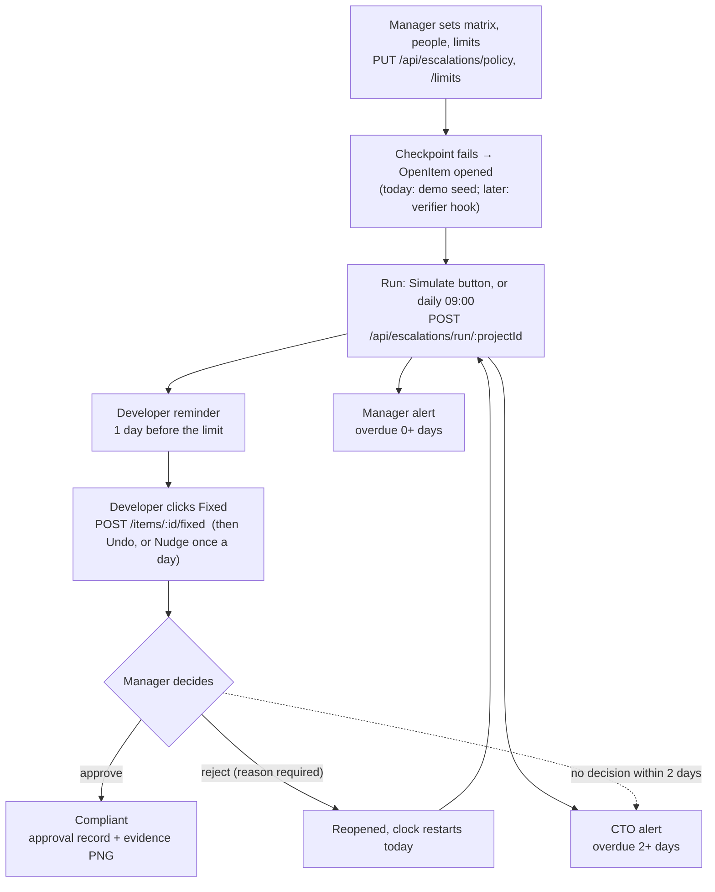

# Prompt: connect the Escalations feature to the backend

> **How to use this file:** put it in the repo root and tell your AI coding assistant (Claude Code, Antigravity, Cursor…):
> *"Read `AI_PROMPT_Backend_Integration.md` and do Phase 1. Stop and report when Phase 1's checks pass."*
> Then repeat for each phase. Don't ask for all phases in one go.
>
> Before starting, unzip `escalation_handover_code.zip` into the repo root so the frontend files this prompt mentions exist.

---

## 0. Your role and the rules you must follow

You are a senior full-stack engineer working in an existing repo: a React frontend plus a FastAPI backend for **Audit Intelligence**, a compliance-monitoring dashboard. The **Escalations** feature is already fully built in the frontend, but all its state lives in the browser's `localStorage`. Your job is to move that state and logic to the backend, so every user sees the same data, **without changing how any screen looks or behaves**.

Hard rules:

1. **Do not change any screen component's UI.** All frontend changes go in `src/lib/escalation-store.tsx`, `src/lib/api-client.ts` and one small change in `src/components/audit/CopilotSimulate.tsx`. If you think another screen file must change, stop and explain why first.
2. **Keep the `useEscalations()` interface the same.** Same names, same arguments, same return shapes. The one allowed exception is that `runEscalation` becomes async (see Phase 3).
3. **Keep the field names exactly** as in `src/lib/escalation-data.ts`. JSON uses camelCase; in Python use snake_case with `Field(alias="camelCase")` and `ConfigDict(populate_by_name=True)`, like the existing models in `backend/app/models.py`. Every route uses `response_model_by_alias=True`.
4. **Port the business rules exactly** (section 4). The numbers on screen, in notifications and in emails must match.
5. **Never send email to real people.** Until the team says otherwise, emails go only to `settings.ms_test_mailbox`. Never put secrets in code or logs; they live in `backend/.env`.
6. **Git:** this repo is connected to Lovable. Never force-push, rebase, amend or squash pushed commits. Work on a branch. Don't commit `package-lock.json` churn, `backend/invites.json`, `backend/escalations.json` or anything in `backend/evidence/`.
7. **Follow the existing code style:** small router file plus a service file, Pydantic models, the same error style (`HTTPException(status_code=…, detail="Plain sentence.")`), comments only where they explain *why*.
8. **After each phase:** run the checks listed for it, then **stop and report**: files changed, what you tested, and anything you were unsure about. Do not move to the next phase on your own.
9. If something in this prompt conflicts with the code you find, **trust the code, tell me about the conflict**, and propose the fix. Don't silently pick one.

---

## 1. What the feature does (the flow)



Roles:

- **Developer:** sees reminders and overdue items ("Overdue & escalated" card), clicks **Fixed**, can **Undo** before the Manager decides, can **Nudge** the Manager once a day while waiting.
- **Manager:** sees "Escalated to you" and "Fixes waiting for your approval". **Approve** marks the item compliant and stores an approval record as evidence. **Reject** needs a reason and restarts the clock. Edits the escalation matrix and people in the Escalations tab.
- **CTO:** sees "Escalated to you" on Home: items 2+ days overdue, and fixes the Manager left undecided past the approval limit.

Projects: `project-a` = **PIT Armour**, `project-b` = **SAATHI**, `project-c` = **MPS**.

---

## 2. Repo map (read these before writing code)

**Frontend** (TanStack Start + React + TypeScript, strict mode with `exactOptionalPropertyTypes`; optional fields are typed `?: T | undefined`):

| File | What it is | Do you change it? |
|---|---|---|
| `src/lib/escalation-data.ts` | Types (`Level`, `Policy`, `ProjectConfig`, `OpenItem`, `Notification`, `RunSummary`, `ApprovalRecord`), defaults, demo seed, rules `resolveLimit()`, `ageItem()`, `daysSince()`, `ageLabel()` | No. It's the reference for the backend port. You may add `evidenceFile?: string \| undefined` to `ApprovalRecord` in Phase 5. |
| `src/lib/escalation-store.tsx` | `EscalationProvider` + `useEscalations()` + `useRoleNotifications()`. All state and actions; saved to localStorage key `audit-intelligence-escalations-v1` | **Yes**, the main frontend change |
| `src/lib/api-client.ts` | `apiFetch<T>(path, init)`, `apiFetchOrNull<T>()`, base URL `VITE_API_BASE_URL` (default `http://localhost:8000`) | **Yes**: add the escalation functions at the end |
| `src/components/audit/CopilotSimulate.tsx` | Simulate button; line ~75 `setRun(esc.runEscalation(projectId))` | **Yes**: `await` it (Phase 3) |
| `src/lib/audit-store.tsx` | Checkpoints (mock `initialCheckpoints`), `resolveCheckpoint(id, status, action, reason, actor)` | No |
| `src/lib/audit-data.ts` | The 85 checkpoints: `id` (`cp-1`…), `ref` (`#1`…), `name`, `category`, `ownerRole`, `projectId` | No; read from it to build the backend catalog |
| `src/routes/escalations.tsx` | Escalations tab (matrix, people, limits). Save calls `esc.setPolicy(pid, draft)` | No |
| `src/components/developer/EscalatedWork.tsx`, `DevSections.tsx`, `DeveloperDashboard.tsx` | Developer screens; call `markFixed`, `nudge`, `withdrawFix`, `canNudge` | No |
| `src/components/manager/EscalationPanels.tsx` | Manager and CTO panels; call `approve(i.id, managerName)`, `reject(i.id, managerName, reason)` | No |
| `src/components/manager/ManagerDashboard.tsx`, `ManagerPortfolio.tsx` | Manager tabs (All projects, PIT Armour, SAATHI, MPS) | No |

**Backend** (`backend/`, FastAPI 0.115, Pydantic 2.10, Python venv at `backend/venv`):

| File | Use it for |
|---|---|
| `app/main.py` | Register the new router. **CORS `allow_methods` is `["GET", "POST"]`; add `"PUT"` and `"DELETE"`.** |
| `app/settings.py` | `frontend_origin`, `ms_*` Graph credentials, `ms_test_mailbox`, `evidence_dir`, `invites_file`. Add `escalations_file: str = "escalations.json"`. |
| `app/models.py` | Pydantic pattern: `model_config = ConfigDict(populate_by_name=True)` and `Field(alias="camelCase")` |
| `app/routers/invites.py` | Router pattern to copy: `APIRouter(prefix=..., tags=[...])`, `HTTPException` |
| `app/services/invites.py` | JSON-file store pattern (`_load()`, `_save()`) and Graph `sendMail` (`_send_invite_email`), to reuse for email |
| `app/clients/evidence_screenshot.py` | Playwright `_render_and_save(page_html, file_name, selector, width)` for the evidence PNG |
| `app/routers/cp10.py` / `cp38.py` | Evidence endpoint pattern returning `{dataUrl}` |
| `app/services/cp10_verify.py`, `cp38_verify.py`, `cr_compliance_verify.py` | Where to hook item creation later (Phase 7) |

Run locally:

```bash
# backend (from backend/)
FRONTEND_ORIGIN=http://localhost:8081 ./venv/Scripts/python -m uvicorn app.main:app --port 8000
# frontend (from repo root)
npx vite dev --port 8081 --strictPort
```

Demo login is shown on the sign-in page. Switch roles with the **View as** dropdown at the top.

---

## 3. Data model (backend must match these exactly)

Create `backend/app/models_escalations.py` (or add a clearly marked section to `models.py`):

```python
from typing import Literal
from pydantic import BaseModel, ConfigDict, Field

Level = Literal["developer", "manager", "cto"]
ItemStatus = Literal["open", "pending-approval", "compliant"]
NotificationKind = Literal["escalation", "approval-stalled", "nudge", "fixed"]

class Person(BaseModel):
    name: str
    email: str = ""

class People(BaseModel):
    developer: Person
    manager: Person
    cto: Person

class Policy(BaseModel):
    model_config = ConfigDict(populate_by_name=True)
    reminder_before_days: int = Field(1, alias="reminderBeforeDays", ge=0)
    manager_after_days: int = Field(0, alias="managerAfterDays", ge=0)
    cto_after_days: int = Field(2, alias="ctoAfterDays", ge=0)
    approval_limit_days: int = Field(2, alias="approvalLimitDays", ge=1)
    people: People

class ProjectConfig(BaseModel):
    model_config = ConfigDict(populate_by_name=True)
    default_limit_days: int | None = Field(None, alias="defaultLimitDays")
    category_limits: dict[str, int] = Field(default_factory=dict, alias="categoryLimits")
    checkpoint_limits: dict[str, int] = Field(default_factory=dict, alias="checkpointLimits")
    policy: Policy

class HistoryEvent(BaseModel):
    at: str      # ISO 8601 UTC
    text: str

class ApprovalRecord(BaseModel):
    model_config = ConfigDict(populate_by_name=True)
    checkpoint_ref: str = Field(alias="checkpointRef")
    checkpoint_name: str = Field(alias="checkpointName")
    project_name: str = Field(alias="projectName")
    fixed_by: str = Field(alias="fixedBy")
    fixed_at: str = Field(alias="fixedAt")
    overdue_days_at_fix: int = Field(alias="overdueDaysAtFix")
    nudges: int
    approved_by: str = Field(alias="approvedBy")
    approved_at: str = Field(alias="approvedAt")
    evidence_file: str | None = Field(None, alias="evidenceFile")   # Phase 5

class OpenItem(BaseModel):
    model_config = ConfigDict(populate_by_name=True)
    id: str
    project_id: str = Field(alias="projectId")
    checkpoint_id: str = Field(alias="checkpointId")
    owner: str
    opened_at: str = Field(alias="openedAt")
    status: ItemStatus
    fixed_at: str | None = Field(None, alias="fixedAt")
    fixed_by: str | None = Field(None, alias="fixedBy")
    overdue_days_at_fix: int | None = Field(None, alias="overdueDaysAtFix")
    approved_at: str | None = Field(None, alias="approvedAt")
    approved_by: str | None = Field(None, alias="approvedBy")
    reject_reason: str | None = Field(None, alias="rejectReason")
    nudges: list[str] = Field(default_factory=list)       # ISO times
    approval: ApprovalRecord | None = None
    history: list[HistoryEvent] = Field(default_factory=list)

class Notification(BaseModel):
    model_config = ConfigDict(populate_by_name=True)
    id: str
    run_at: str = Field(alias="runAt")
    project_id: str = Field(alias="projectId")
    item_id: str = Field(alias="itemId")
    recipient: Level
    kind: NotificationKind
    title: str
    detail: str

class RunSummary(BaseModel):
    model_config = ConfigDict(populate_by_name=True)
    run_at: str = Field(alias="runAt")
    project_id: str = Field(alias="projectId")
    counts: dict[Level, int]
    notifications: list[Notification]
    email_note: str = Field(alias="emailNote")

class ItemActionResponse(BaseModel):
    item: OpenItem
    notifications: list[Notification] = Field(default_factory=list)
```

**Important: `null` vs missing.** The frontend uses `undefined` for missing optional fields. Serialize with `response_model_exclude_none=True` on item and run routes so optional fields are omitted rather than `null`, or make sure the frontend treats `null` like `undefined`. Check `rejectReason`, `fixedAt`, `approval` and `defaultLimitDays` specifically.

**Defaults** (copy from `escalation-data.ts`):

- Org default limit: **2 days** (`ORG_DEFAULT_LIMIT_DAYS`).
- Policy: reminder 1, managerAfter 0, ctoAfter 2, approvalLimit 2.
- People: manager "Neha Gupta", CTO "CTO", developer per project: `project-a` "Rahul Verma", `project-b` "Vivek Pillai", `project-c` "Karan Mehta". All emails `""`.
- `GET /config/{projectId}` for a project never saved returns these defaults; it must not 404.

**Checkpoint catalog.** The backend needs each checkpoint's `ref`, `name` and `category` for limit resolution and notification titles. These live only in `src/lib/audit-data.ts` today (85 checkpoints, ids `cp-1`…). Generate `backend/app/data/checkpoints.json` with `[{id, ref, name, category, ownerRole}]` (write a small one-off script, or copy by hand) and load it once at startup. Example: `{"id": "cp-15", "ref": "#15", "name": "Rollback plan is documented before deployment", "category": "Change Management", "ownerRole": "DevOps"}`. Title format is `"{ref} {name}"`, e.g. `"#15 Rollback plan is documented before deployment"`.

**Storage.** Phase 1–4: one JSON file (`settings.escalations_file`), same `_load()` / `_save()` pattern as invites, with this shape:

```json
{ "configs": { "project-a": { ...ProjectConfig } },
  "items": [ ...OpenItem ],
  "notifications": [ ...Notification ],
  "lastRun": { "project-a": { ...RunSummary } } }
```

Guard writes with a `threading.Lock` (or an `asyncio.Lock`) so two requests can't overwrite each other. Keep at most 300 notifications, newest first, as the frontend does. Write the service so storage is behind small functions (`load_state()`, `save_state()`), so moving to a real database later only touches those.

**Demo seed** (relative to "now"; ids are `esc-<checkpointId>`):

| projectId | checkpointId | owner | opened (days ago) | fixed (days ago) | status |
|---|---|---|---|---|---|
| project-a | cp-15 | Rahul Verma | 4 | | open |
| project-a | cp-21 | Rahul Verma | 4 | | open |
| project-a | cp-8 | Rahul Verma | 2 | | open |
| project-a | cp-19 | Rahul Verma | 1 | | open |
| project-a | cp-6 | Rahul Verma | 6 | 3 | pending-approval |
| project-b | cp-25 | Vivek Pillai | 5 | | open |
| project-b | cp-60 | Sneha Kapoor | 2 | | open |
| project-c | cp-28 | Karan Mehta | 3 | | open |
| project-c | cp-71 | Manoj Kumar | 5 | 2 | pending-approval |

For seeded fixed items: `fixedBy = owner`, `overdueDaysAtFix = max(0, opened − fixed − 2)`, history `[{at: opened, text: "Opened (demo seed)"}, {at: fixed, text: "Marked fixed by <owner>"}]` (open items get only the first line). Match `seedItems()` in `escalation-data.ts` exactly. Seed when the store file doesn't exist, and on `POST /demo/reset`.

---

## 4. Business rules (port these exactly)

Reference implementation in Python; the TypeScript originals are `resolveLimit`, `daysSince` and `ageItem` in `src/lib/escalation-data.ts`, plus `runEscalation`, `markFixed`, `withdrawFix`, `canNudge`, `nudge`, `approve` and `reject` in `src/lib/escalation-store.tsx`. **Read both TypeScript files, then port.** Use UTC everywhere, with timestamps as ISO 8601 strings (`datetime.now(timezone.utc).isoformat().replace("+00:00", "Z")`).

```python
DAY = 86400  # seconds

def days_since(iso: str, now: datetime) -> int:
    return max(0, math.floor((now - parse_iso(iso)).total_seconds() / DAY))

def resolve_limit(cfg: ProjectConfig, checkpoint_id: str, category: str) -> int:
    if checkpoint_id in cfg.checkpoint_limits: return cfg.checkpoint_limits[checkpoint_id]
    if category in cfg.category_limits:       return cfg.category_limits[category]
    if cfg.default_limit_days is not None:     return cfg.default_limit_days
    return 2  # ORG_DEFAULT_LIMIT_DAYS

def age_item(item, cfg, category, now):
    open_days = days_since(item.opened_at, now)
    limit = resolve_limit(cfg, item.checkpoint_id, category)
    overdue = open_days - limit            # negative = days left
    p = cfg.policy
    if overdue >= p.cto_after_days:              level = "cto"
    elif overdue >= p.manager_after_days:        level = "manager"
    elif -overdue <= p.reminder_before_days:     level = "developer"
    else:                                        level = None
    return open_days, limit, overdue, level
```

`ageLabel` text, used in notification `detail` (match it exactly, including the `·` separators and singular "day"):

- `"Open 4 days · limit 2 days · 2 days overdue"`
- `"Open 2 days · limit 2 days · due today"`
- `"Open 1 day · limit 2 days · 1 day left"`

**Run (`POST /run/{projectId}`)**, for each item in the project:

- **status `open`** with a level:
  - level `developer` → notify the developer: `detail = label`.
  - level `manager` → notify the developer (`label`) and the manager (`label + " · owner <owner>"`).
  - level `cto` → notify all three; CTO `detail = label + " · owner <owner> · Manager <manager name>"`.
  - Append to history: `"Reminder sent to the developer (Simulate run)"` or `"Escalated to <Manager|CTO> (Simulate run)"`.
  - No level → nothing.
- **status `pending-approval`**, with `waiting = days_since(fixedAt)` ≥ `approvalLimitDays` → notify the CTO with `kind "approval-stalled"`, `detail = "Fix waiting <n> days for <manager>'s approval (limit <n> days)"`. History: `"Approval stalled <n> days, CTO notified (Simulate run)"`.
- All notifications in a run share one `runAt`. All have `kind "escalation"` except approval-stalled. `title = "<ref> <name>"`.
- **Every run notifies again**: no "already sent" suppression.
- `counts` = notifications per recipient.
- `emailNote`:
  - If any person in the policy has an email: `"Email not sent: the mail service is not connected to this dashboard yet. Notifications are on each dashboard."`
  - Otherwise: `"Email off: no recipient emails set in the Escalations tab. Notifications are on each dashboard."`
  - Phase 6 replaces this with what actually happened.
- Save the summary as `lastRun[projectId]`.

**Item actions** (`by` = acting person's name; `now` = current time):

| Action | Allowed from | Effect | Notification | History line |
|---|---|---|---|---|
| fixed | `open` | status `pending-approval`; `fixedAt = now`; `fixedBy = owner`; `overdueDaysAtFix = max(0, overdue)`; `rejectReason = None`; `nudges = []` | to **manager**, kind `fixed`: `"<owner> marked this fixed and needs your approval"` | `"Marked fixed by <owner>, waiting for <manager>"` |
| undo | `pending-approval` | status `open`; clear `fixedAt`, `fixedBy`, `overdueDaysAtFix`, `nudges`; **keep `openedAt`** | none | `"Fix withdrawn by <owner>"` |
| nudge | `pending-approval`, and last nudge ≥ 24 h ago (else **429**) | append `now` to `nudges` | to **manager**, kind `nudge`: `"<owner> is waiting on your approval (nudge <n>)"`, where n = new count | `"<owner> nudged the Manager"` |
| approve | `pending-approval` | status `compliant`; `approvedAt`, `approvedBy`; build `ApprovalRecord` (`nudges` = count; `projectName` from the project id: PIT Armour / SAATHI / MPS) | to **developer**, kind `fixed`: `"<by> approved your fix. It is now compliant."` | `"Approved by <by>, now compliant"` |
| reject | `pending-approval`; `reason` non-blank (else **422**) | status `open`; **`openedAt = now`** (clock restarts); clear `fixedAt`, `fixedBy`, `nudges`; `rejectReason = reason` | to **developer**, kind `escalation`: `"<by> rejected your fix: <reason>"` | `"Rejected by <by>: <reason>. Clock restarted"` |

Wrong status → **409** with a plain sentence, e.g. `"This item is not waiting for approval."`. Unknown id → **404**. Each action returns `ItemActionResponse`.

---

## 5. API contract

Router: `backend/app/routers/escalations.py`, `APIRouter(prefix="/api/escalations", tags=["escalations"])`. Service: `backend/app/services/escalations.py` (all logic goes here; the router stays thin).

| # | Method and path | Body | Returns | Replaces in the store |
|---|---|---|---|---|
| 1 | `GET /config/{projectId}` | | `ProjectConfig` (defaults if never saved) | `getConfig` |
| 2 | `PUT /policy/{projectId}` | `Policy` | `ProjectConfig` | `setPolicy`, `setPerson` |
| 3 | `PUT /limits/{projectId}` | `{defaultLimitDays?, categoryLimits?, checkpointLimits?}`. A key present with `null` removes that override; a missing key means no change | `ProjectConfig` | `setDefaultLimit`, `setCategoryLimit`, `setCheckpointLimit` |
| 4 | `DELETE /config/{projectId}` | | `ProjectConfig` (defaults) | `resetProject` |
| 5 | `GET /items?projectId=` | | `OpenItem[]`; no projectId = all | `items` |
| 6 | `POST /run/{projectId}` | | `RunSummary` | `runEscalation` |
| 7 | `GET /runs/latest` | | `{ [projectId]: RunSummary }` | `lastRun` |
| 8 | `POST /items/{id}/fixed` | | `ItemActionResponse` | `markFixed` |
| 9 | `POST /items/{id}/undo` | | `ItemActionResponse` | `withdrawFix` |
| 10 | `POST /items/{id}/nudge` | | `ItemActionResponse` / 429 | `nudge` |
| 11 | `POST /items/{id}/approve` | `{"by": "Neha Gupta"}` | `ItemActionResponse` | `approve` |
| 12 | `POST /items/{id}/reject` | `{"by": "...", "reason": "..."}` | `ItemActionResponse` / 422 | `reject` |
| 13 | `GET /notifications?role=&projectId=&since=` | | `Notification[]` newest first; all filters optional | `notifications` |
| 14 | `POST /demo/reset` | | `{ "ok": true }`; reseeds items, clears notifications and runs (configs kept) | `resetDemo` |
| 15 | `GET /items/{id}/evidence` (Phase 5) | | `{ "dataUrl": "data:image/png;base64,..." }` or 404 | new |

Validate `projectId` against `project-a`, `project-b` and `project-c` (404 otherwise).

---

## 6. Frontend changes (only these files)

### 6a. `src/lib/api-client.ts`: append

Add one typed function per endpoint, using the existing `apiFetch`. Import the types from `@/lib/escalation-data`. Example shape:

```ts
// --- Escalations ---------------------------------------------------------
import type { OpenItem, Notification, Policy, ProjectConfig, RunSummary, Level } from "@/lib/escalation-data";
import type { ProjectId } from "@/lib/audit-data";

type ItemAction = { item: OpenItem; notifications: Notification[] };
const E = "/api/escalations";

export const getEscalationConfig = (pid: ProjectId) => apiFetch<ProjectConfig>(`${E}/config/${pid}`);
export const saveEscalationPolicy = (pid: ProjectId, policy: Policy) =>
  apiFetch<ProjectConfig>(`${E}/policy/${pid}`, { method: "PUT", body: JSON.stringify(policy) });
export const saveEscalationLimits = (pid: ProjectId, patch: { defaultLimitDays?: number | null; categoryLimits?: Record<string, number | null>; checkpointLimits?: Record<string, number | null> }) =>
  apiFetch<ProjectConfig>(`${E}/limits/${pid}`, { method: "PUT", body: JSON.stringify(patch) });
export const resetEscalationConfig = (pid: ProjectId) => apiFetch<ProjectConfig>(`${E}/config/${pid}`, { method: "DELETE" });
export const listEscalationItems = () => apiFetch<OpenItem[]>(`${E}/items`);
export const runEscalationApi = (pid: ProjectId) => apiFetch<RunSummary>(`${E}/run/${pid}`, { method: "POST" });
export const getLatestRuns = () => apiFetch<Partial<Record<ProjectId, RunSummary>>>(`${E}/runs/latest`);
export const itemAction = (id: string, action: "fixed" | "undo" | "nudge") =>
  apiFetch<ItemAction>(`${E}/items/${encodeURIComponent(id)}/${action}`, { method: "POST" });
export const approveItem = (id: string, by: string) =>
  apiFetch<ItemAction>(`${E}/items/${encodeURIComponent(id)}/approve`, { method: "POST", body: JSON.stringify({ by }) });
export const rejectItem = (id: string, by: string, reason: string) =>
  apiFetch<ItemAction>(`${E}/items/${encodeURIComponent(id)}/reject`, { method: "POST", body: JSON.stringify({ by, reason }) });
export const listNotifications = (q: { role?: Level; projectId?: ProjectId; since?: string } = {}) =>
  apiFetch<Notification[]>(`${E}/notifications?${new URLSearchParams(q as Record<string, string>)}`);
export const resetEscalationDemo = () => apiFetch<{ ok: boolean }>(`${E}/demo/reset`, { method: "POST" });
```

Put imports at the top of the file, not in the middle, if the linter complains.

### 6b. `src/lib/escalation-store.tsx`: rewire

Keep the `Ctx` type and every exported name. Change only the internals:

1. **Load:** replace the first `useEffect` (localStorage, seed, SAATHI/MPS migration). On mount, fetch `listEscalationItems()`, `getEscalationConfig()` for the 3 projects, `getLatestRuns()` and `listNotifications()` in parallel, then `setState` and `setReady(true)`. On failure, keep `ready` false, store an `error` string in state, and `console.error` it. Don't crash the page.
2. **Sync:** delete the save `useEffect`, the `skipSave` ref and the `storage` event listener. Add a refresh: re-fetch items, notifications and latest runs every **30 s** and on `window` `focus`. Clear the interval on unmount.
3. **Config actions:**
   - `setPolicy(pid, patch)`: merge into the current policy, `PUT` the whole policy, put the response into `configs[pid]`.
   - `setPerson`: same thing, via `setPolicy`.
   - `setDefaultLimit` / `setCategoryLimit` / `setCheckpointLimit`: send only the changed key, with `undefined` sent as `null`.
   - `resetProject`: `DELETE`.
   - Update local state optimistically, then replace it with the server response. If the call fails, roll back and `console.error`.
4. **`runEscalation`:** becomes `async (pid) => Promise<RunSummary>`. Call the API, then merge: prepend the new notifications, set `lastRun[pid]`, re-fetch items (the history changed). Change its type in `Ctx` to return `Promise<RunSummary>`.
5. **Item actions** (`markFixed`, `withdrawFix`, `nudge`, `approve`, `reject`): call the endpoint, replace that item in `state.items` with `res.item`, and prepend `res.notifications`. They may stay fire-and-forget (`void` the promise) so callers don't change; catch errors and `console.error` them.
6. **`approve`:** keep the existing `resolveCheckpoint(item.checkpointId, "compliant", "Approved", ...)` call after success, so the checkpoint flips in the UI at once.
7. **`resetDemo`:** call `resetEscalationDemo()`, then re-run the load.
8. **Keep client-side:** `ageOf`, `canNudge`, `meta`, `getConfig` (now reads fetched configs, falling back to `emptyConfig(pid)` until loaded), `useRoleNotifications`.
9. **Remove** `STORAGE_KEY`, `fresh()` and the `seedItems` import if unused. Leave `seedItems` / `DEMO_SEED` in `escalation-data.ts`; they're the reference for the backend seed.

### 6c. `src/components/audit/CopilotSimulate.tsx`

Make `simulate` async: `setRun(await esc.runEscalation(projectId))`. Disable the button while it's running, and show the error text if the call throws. Change nothing else in the file.

---

## 7. Phases (do one, verify, stop, report)

### Phase 1: Storage + config

- Models, settings (`escalations_file`), checkpoint catalog JSON, service `load_state`/`save_state` with a lock, endpoints 1–4, router registered, CORS PUT/DELETE.
- Frontend: api-client functions for config; store loads configs from the API; config actions call it.
- **Check:** `curl localhost:8000/api/escalations/config/project-a` returns the defaults. In the Escalations tab, change "CTO after" to 3 and click Save. The value survives a reload, and a second browser (incognito) shows 3. `npx tsc --noEmit -p .` shows no **new** errors (there are pre-existing errors in `routes/index.tsx` and `routes/projects.tsx`; leave those).

### Phase 2: Items + rules + seed

- Port `days_since`, `resolve_limit`, `age_item`, `age_label` and the seed. Endpoints 5 and 14.
- **Unit tests** (`backend/tests/test_escalation_rules.py`, pytest; add `pytest` to requirements-dev or note it): limit inheritance order; the three `ageLabel` examples; levels at the boundaries (overdue = ctoAfter, = managerAfter, days left = reminderBefore, one more day left → None).
- Frontend: store loads items from the API.
- **Check:** the Developer, Manager and CTO views show the same items as before (PIT Armour 5, SAATHI 2, MPS 2), now from the server.

### Phase 3: Run

- Endpoints 6, 7, 13. `runEscalation` async in the store and `CopilotSimulate.tsx`.
- **Unit test:** a fresh seed plus a run on `project-a` with default config gives `counts == {"developer": 4, "manager": 3, "cto": 3}`. That's cp-15 and cp-21 → all three levels, cp-8 → developer and manager, cp-19 → developer, cp-6 → stalled approval to the CTO.
- **Check:** click Simulate on the PIT Armour project page; the result panel shows the same counts. Manager Home "Escalated to you" and CTO Home show the alerts in **another browser**.

### Phase 4: Item actions

- Endpoints 8–12 plus the store wiring. Delete all remaining localStorage code for escalations.
- **Unit tests:** every row of the item-actions table, including 409, 422 and 429.
- **Check (two browsers):**
  - A (Developer) clicks Fixed on #15. Within 30 s, B (Manager) sees it in "Fixes waiting for your approval".
  - B approves. A sees it gone and the approval message.
  - Reject with a reason restarts the clock and shows the reason to the developer.
  - Undo keeps the original opened date.
  - A second nudge the same day is refused and the button reads "again tomorrow".

**After Phase 4 the demo works across browsers. Stop here and report before continuing.**

### Phase 5: Approval evidence PNG

- On approve, render the `ApprovalRecord` as a simple HTML card (project, checkpoint, fixed by and when, overdue days at fix, nudges, approved by and when) and save it with `_render_and_save()` into `settings.evidence_dir` as `escalation-<itemId>-<timestamp>.png`. Store the name in `approval.evidenceFile`. Add endpoint 15.
- If Playwright fails, still approve, and log the failure. Evidence must never block an approval.
- Frontend (optional, ask first): `ApprovalRecordCard` in `EscalationPanels.tsx` could show a "View evidence" link. This touches a screen file, so ask before doing it.

### Phase 6: Email + daily scheduler

- **Email:** reuse the Graph `sendMail` code from `app/services/invites.py`. After a run, group notifications by recipient level and send **one email per recipient** listing their items. **Send every email to `settings.ms_test_mailbox`**, with the intended recipient named in the body, until the team explicitly turns on real delivery with a setting such as `escalation_email_live: bool = False`. If Graph isn't configured, skip sending and say so in `emailNote`. Set `emailNote` to what actually happened, e.g. `"Emailed 3 people (test mailbox)."`.
- **Scheduler:** a daily run per project at 09:00 Asia/Kolkata (`tzdata` is already installed) that calls the same service function as `POST /run`. Prefer APScheduler started in a FastAPI `lifespan` handler, behind a setting `escalation_schedule_enabled: bool = False`. Ask before adding a dependency.

### Phase 7: Auth, roles and item creation (needs team decisions; ask first)

- `GET /api/me` → `{name, role, projectIds}`. Today the frontend role comes from the View as picker (`src/lib/role-store.tsx`) and login is a demo session (`src/lib/auth-store.tsx`). Propose how real login should work before building it.
- Permission checks:
  - Fixed, Undo, Nudge: the item's owner.
  - Approve, Reject: the project's manager.
  - Edit the matrix: Manager or admin.
  - Edit limits: admin.
  - Run and demo reset: admin or manager.
  - Notifications: only the caller's own.
- Accept invite tokens (`app/routers/invites.py`) as a developer identity for their one project.
- **Item creation:** when a verifier (`cp10_verify.py`, `cp38_verify.py`, `cr_compliance_verify.py`) returns non-compliant, call `open_item(project_id, checkpoint_id, owner)`, unless an open or pending item already exists for that checkpoint. **Open question, ask the team:** when a checkpoint passes again on its own, should the item close automatically, or still wait for the Manager's approval?

---

## 8. Final acceptance checklist

- [ ] A fresh seed plus Simulate on PIT Armour gives Developer 4, Manager 3, CTO 3.
- [ ] A checkpoint limit of 5 days on #15 drops it out of Manager and CTO on the next run.
- [ ] Fixed in browser A appears in Manager browser B within 30 s.
- [ ] Nudge twice the same day: the second returns 429, and the UI shows "again tomorrow".
- [ ] Undo keeps `openedAt`; Reject resets it and shows the reason.
- [ ] Approve: item compliant, checkpoint compliant, approval record stored (and a PNG after Phase 5).
- [ ] Approve on an open item returns 409; Reject with a blank reason returns 422.
- [ ] A fix pending 3 days with approval limit 2: the CTO gets "approval stalled" on the next run.
- [ ] Manager "All projects" counts equal the three project tabs added up.
- [ ] Reloading any page keeps everything (nothing comes from localStorage any more).
- [ ] No email reaches a real person.
- [ ] `npx tsc --noEmit -p .` shows no new errors; backend tests pass.

## 9. How to report after each phase

Reply with:

1. **Done:** what now works, in one or two lines.
2. **Files changed:** path plus one line each.
3. **How I tested:** commands and results, including test counts and curl output.
4. **Not done / unsure:** anything skipped, any conflict between this prompt and the code, and questions for the team.

Don't claim something works unless you ran it.
